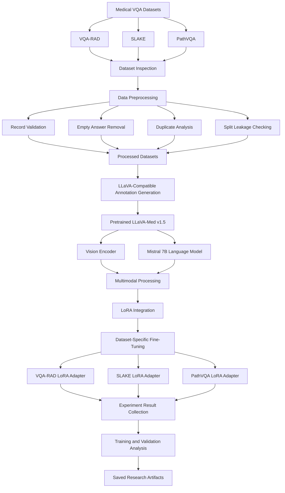
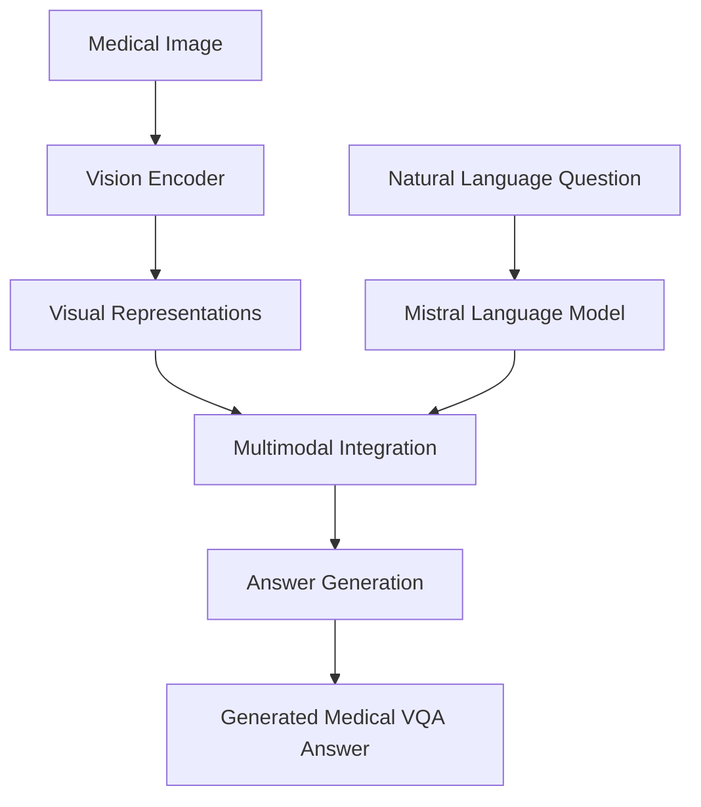
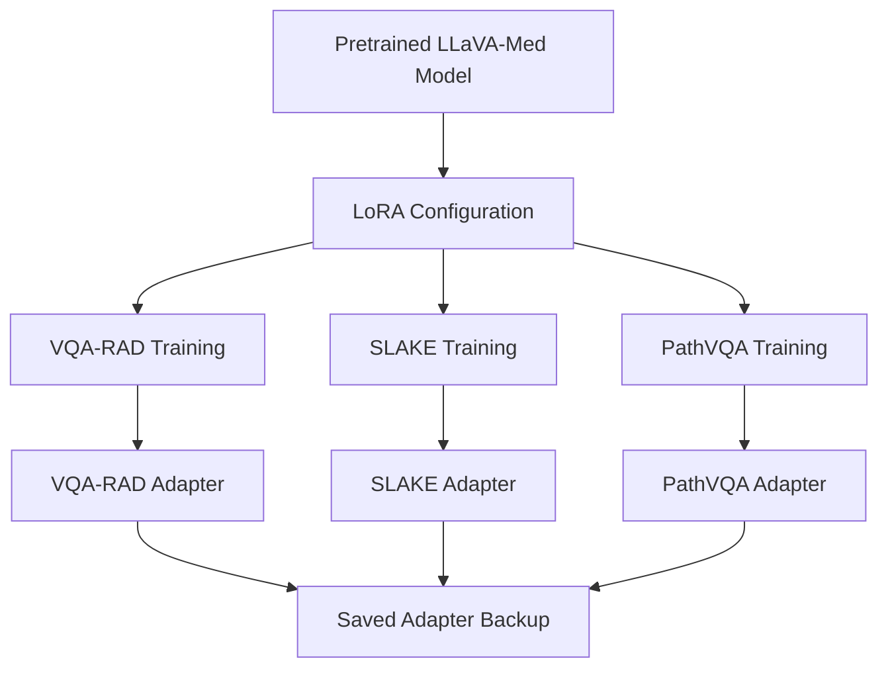

# Medical VQA Using Parameter-Efficient Fine-Tuning

# 1. System Architecture

## 1.1 Project Overview

This project implements a Medical Visual Question Answering (Medical VQA)
research pipeline using the LLaVA-Med v1.5 Mistral 7B vision-language model.

The project investigates Parameter-Efficient Fine-Tuning (PEFT) using
Low-Rank Adaptation (LoRA) on three medical question-answering datasets:

- VQA-RAD
- SLAKE
- PathVQA

The objective is to adapt a pretrained medical vision-language model
to medical image question answering while updating only a small
fraction of the model parameters.

# 2. Overall System Architecture

The complete system consists of the following stages:

1. Medical VQA dataset acquisition.
2. Dataset inspection and preprocessing.
3. Data validation and leakage checking.
4. LLaVA-compatible annotation generation.
5. Pretrained vision-language model loading.
6. LoRA configuration and integration.
7. Dataset-specific model fine-tuning.
8. Adapter checkpoint generation and backup.
9. Experiment result collection and analysis.

## 2.1 Architecture Diagram

# 3. Dataset Layer

## 3.1 VQA-RAD

VQA-RAD is a radiology-based Medical VQA dataset containing
medical images paired with natural-language questions and answers.

Processed dataset split:

| Split | Records |
|---|---:|
| Training | 1,791 |
| Validation | 216 |
| Testing | 241 |
| Total | 2,248 |

## 3.2 SLAKE

SLAKE is a knowledge-enriched Medical VQA dataset containing
medical images and associated question-answer pairs.

Processed dataset split:

| Split | Records |
|---|---:|
| Training | 4,918 |
| Validation | 1,053 |
| Testing | 1,061 |
| Total | 7,032 |

## 3.3 PathVQA

PathVQA is a Medical VQA dataset focused on pathology images
and associated questions and answers.

Processed dataset split:

| Split | Records |
|---|---:|
| Training | 19,648 |
| Validation | 6,259 |
| Testing | 6,719 |
| Total | 32,626 |

Important experimental distinction:

The full processed PathVQA dataset contains 19,648 training
and 6,259 validation records.

Due to computational constraints, the actual LoRA training
experiment used a reduced subset:

- Training records: 3,916
- Validation records: 500

These experimental counts must not be confused with the
full processed dataset counts.

# 4. Data Preprocessing Architecture

The preprocessing layer prepares the original medical
question-answer datasets for multimodal model training.

## 4.1 Dataset Inspection

The inspection stage examines:

- Dataset structure.
- Available image files.
- Question-answer records.
- Existing train, validation and test splits.
- Missing or invalid fields.

Implementation:

`preprocessing/inspect_datasets.py`

## 4.2 Data Cleaning

The cleaning stage prepares consistent records by handling
invalid and incomplete entries.

The project includes removal of records with empty answers
and analysis of duplicate records.

Implementation:

`preprocessing/prepare_data.py`

## 4.3 Duplicate Analysis

Duplicate analysis identifies repeated records that may
affect dataset quality.

Implementation:

`preprocessing/analyze_duplicates.py`

## 4.4 Split Leakage Validation

Split leakage checking examines whether records or images
overlap across training, validation and testing partitions.

Implementation:

`preprocessing/check_split_leakage.py`

## 4.5 Dataset Validation

The validation scripts check the integrity of the prepared
dataset and its required fields.

Implementations:

- `preprocessing/validate_data.py`
- `preprocessing/validate_processed_data.py`

## 4.6 LLaVA Annotation Conversion

The processed question-answer records are converted into
a LLaVA-compatible conversation format.

A typical record contains:

- Image reference.
- Human question.
- Assistant answer.

The human message uses the image marker to identify the
visual input, while the assistant message contains the
reference answer.

Implementation:

`train_pipeline.py`

The annotation files are validated using:

`validate_llava_data.py`

## 4.7 Processed Dataset Counts

| Dataset | Training | Validation | Testing |
|---|---:|---:|---:|
| VQA-RAD | 1,791 | 216 | 241 |
| SLAKE | 4,918 | 1,053 | 1,061 |
| PathVQA | 19,648 | 6,259 | 6,719 |
| Total | 26,357 | 7,528 | 8,021 |

Total processed records: 41,906.

# 5. Model Architecture

## 5.1 Selected Base Model

Model identifier:

`microsoft/llava-med-v1.5-mistral-7b`

Architecture family:

LLaVA vision-language architecture with a Mistral 7B
language-model backbone.

The pretrained model provides the foundation for processing
medical images and natural-language questions.

## 5.2 Vision-Language Processing

The model combines visual information and language processing.

The conceptual processing sequence is:

1. A medical image is supplied as visual input.
2. The vision encoder extracts visual representations.
3. The natural-language question is processed through the
   language-model pathway.
4. Visual information is integrated with language context.
5. The language model generates a natural-language answer.

## 5.3 Conceptual Model Flow

# 6. Parameter-Efficient Fine-Tuning

## 6.1 Why PEFT?

Large vision-language models contain billions of parameters.
Updating every parameter during fine-tuning can require
substantial computational resources.

Parameter-Efficient Fine-Tuning reduces the number of
parameters that must be updated.

This project uses Low-Rank Adaptation.

## 6.2 LoRA Mechanism

LoRA introduces trainable low-rank matrices into selected
linear layers of a pretrained model.

Instead of updating the original pretrained weight matrix,
LoRA learns a low-rank update.

Conceptually:

W_new = W_original + Delta_W

Delta_W = B x A

Here:

- W_original represents the pretrained weight matrix.
- A and B are trainable low-rank matrices.
- Delta_W represents the learned weight update.

The original pretrained weights remain frozen during
the LoRA fine-tuning process.

## 6.3 LoRA Configuration

| Parameter | Value |
|---|---|
| Fine-tuning method | LoRA |
| Rank | 8 |
| Alpha | 16 |
| Dropout | 0.05 |
| Target modules | q_proj, v_proj |
| Bias | none |
| Task type | CAUSAL_LM |

The target modules correspond to query and value projection
layers in the attention mechanism.

## 6.4 Trainable Parameter Statistics

| Parameter | Value |
|---|---:|
| Total parameters | 7,570,413,568 |
| Trainable parameters | 4,194,304 |
| Trainable percentage | Approximately 0.0554% |

This demonstrates that only a small proportion of the
model parameters are updated during fine-tuning.

# 7. Training Architecture

## 7.1 Experimental Environment

The fine-tuning experiments were conducted using Kaggle
GPU environments with NVIDIA T4 GPUs.

## 7.2 Training Configuration

| Parameter | Value |
|---|---|
| Base model | LLaVA-Med v1.5 Mistral 7B |
| Fine-tuning | LoRA |
| Epochs | 1 |
| Learning rate | 0.0002 |
| Training batch size | 1 |
| Evaluation batch size | 1 |
| Gradient accumulation | 8 |
| Warmup ratio | 0.03 |
| Weight decay | 0.01 |
| Precision | FP16 |
| Random seed | 42 |

## 7.3 Dataset-Specific Training

The same base model and LoRA configuration were used
for three separate dataset-specific experiments.

Each experiment generates its own adapter output.

# 8. Experimental Results

The saved experiment metadata records the following results.

| Dataset | Training Samples | Validation Samples | Training Loss | Validation Loss |
|---|---:|---:|---:|---:|
| VQA-RAD | 1,791 | 216 | 0.929398 | 0.805412 |
| SLAKE | 4,918 | 1,053 | 0.403944 | 0.192734 |
| PathVQA | 3,916 | 500 | 0.897355 | 0.666940 |

## 8.1 Training Time and GPU Memory

| Dataset | Training Time | Peak GPU Memory |
|---|---|---:|
| VQA-RAD | 2h 09m 27s | 7.36 GB |
| SLAKE | 6h 37m 16s | 7.37 GB |
| PathVQA | 4h 46m 52s | 7.38 GB |

## 8.2 Interpretation

All three experiments completed and generated LoRA adapter
backups.

Training loss and validation loss represent optimization
metrics recorded during model fine-tuning.

They are not equivalent to answer accuracy.

The loss values should not be interpreted as a direct
performance ranking across the three datasets because
their question-answer distributions and experiment sizes
are different.

Held-out test accuracy and clinical reliability have not
been established by the recorded experiments.

# 9. Adapter Storage and Model Loading

The three experiment archives preserve the trained LoRA
adapter outputs.

| Dataset | Adapter Archive |
|---|---|
| VQA-RAD | VQA_RAD_backup.zip |
| SLAKE | SLAKE_LoRA_Backup.zip |
| PathVQA | PathVQA_LoRA_Backup.zip |

The archives contain adapter weights, adapter configuration
and associated experiment files.

The adapter weights are not complete standalone models.
The compatible LLaVA-Med base model must also be available
when loading an adapter.

The repository model-loading implementation supports
loading a pretrained model and optionally attaching a
PEFT adapter.

# 10. Evaluation Architecture

The project separates software validation from model
performance evaluation.

## 10.1 Software Testing

The automated test suite covers:

- Dataset loading and validation.
- Data collation and batching.
- Evaluation utility functions.
- LoRA configuration.
- LoRA application.
- Trainable parameter summaries.

The recorded test run completed with:

| Test Module | Passed |
|---|---:|
| test_data.py | 23 |
| test_evaluation.py | 9 |
| test_training.py | 10 |
| Total | 42 |

Recorded result: 42 passed in 17.91 seconds.

## 10.2 Model Evaluation

Answer-level evaluation was performed using the saved prediction files
generated from the Kaggle test datasets.

The evaluation uses two metrics:

- Exact Match (EM): percentage of predictions matching the normalized
  reference answer exactly.
- Token-level F1: overlap-based F1 calculated from normalized answer tokens.

### Test Evaluation Results

| Dataset | Test Samples Evaluated | Exact Match | Token F1 |
|---|---:|---:|---:|
| VQA-RAD | 241 | 54.36% | 57.68% |
| SLAKE | 1,061 | 74.55% | 79.10% |
| PathVQA | 500 | 43.00% | 45.83% |
| Total | 1,802 | — | — |

PathVQA evaluation used a 500-example test subset rather than the
complete processed test split of 6,719 records.

### Evaluation Implementation

- `evaluation/metrics.py` — answer normalization and metric calculations.
- `evaluation/evaluate.py` — loads prediction records and computes metrics.
- `evaluation/run_evaluation.py` — evaluates all three datasets and saves
  the combined results.
- `results/experiment_1/predictions/` — saved prediction records.
- `results/experiment_1/metrics/experiment_1_results.json` — combined metrics.
- `evaluation/visualize_results.py` — generates comparison charts.
- `results/experiment_1/figures/` — generated evaluation visualizations.

Run the evaluation from the project root using:

`python -m evaluation.run_evaluation`

The reported metrics use the project's own normalization and token-overlap
implementation. They should not be interpreted as official benchmark VQA
scores or as evidence of clinical reliability.
# 11. Repository Component Mapping

| Component | Responsibility |
|---|---|
| configs/config.yaml | Central project configuration |
| preprocessing/ | Data preparation and validation |
| train_pipeline.py | LLaVA-format annotation generation |
| dataset.py | Dataset representation and utilities |
| dataset_loader.py | Dataset loading |
| model_loader.py | Base model and adapter loading |
| peft_methods.py | LoRA configuration and integration |
| evaluate_pipeline.py | Evaluation utilities |
| validate_llava_data.py | LLaVA annotation validation |
| tests/ | Automated software tests |
| results/adapters/ | Dataset-specific adapter backups |
| results/EXPERIMENT_RESULTS.md | Consolidated experiment results |
| docs/architecture.md | System architecture documentation |

# 12. End-to-End Project Workflow

The complete project workflow can be summarized as:

1. Acquire the three Medical VQA datasets.
2. Inspect the raw dataset structures.
3. Clean and validate the question-answer records.
4. Analyze duplicate records.
5. Check split leakage.
6. Generate LLaVA-compatible annotations.
7. Validate annotation files and image references.
8. Load the LLaVA-Med v1.5 Mistral 7B base model.
9. Configure LoRA with rank 8 and alpha 16.
10. Fine-tune separately on VQA-RAD, SLAKE and PathVQA.
11. Save each dataset-specific LoRA adapter.
12. Record training loss, validation loss, training time
    and peak GPU memory.
13. Preserve the adapter archives and experiment metadata.
14. Run automated software tests.
15. Evaluate saved predictions using Exact Match and token-level F1.
16. Generate dataset-wise evaluation comparison charts.

# 13. Limitations

- The recorded experiments use one training epoch.
- PathVQA uses a reduced training and validation subset.
- PathVQA answer-level evaluation covers a 500-example test subset, not the complete test split.
- The complete base model weights are not included in
  the adapter ZIP archives.
- Full medical image datasets must be available locally
  for complete data reproduction.
- The model has not been clinically validated.

# 14. Future Improvements

Potential future work includes:

- Additional fine-tuning epochs.
- Complete PathVQA subset expansion.
- Held-out test evaluation.
- Exact-match and token-level evaluation metrics.
- Qualitative prediction analysis.
- Error analysis across question categories.
- Cross-dataset generalization experiments.
- A reproducible inference interface for all three adapters.
- Complete dependency and environment documentation.

# 15. Conclusion

The project establishes a data preparation and
parameter-efficient fine-tuning workflow for Medical VQA
using LLaVA-Med v1.5 Mistral 7B.

Three datasets were processed and converted into
LLaVA-compatible annotations. Dataset-specific LoRA
experiments were completed, and three adapter backups
were generated.

The work provides a foundation for further investigation
of parameter-efficient adaptation of large vision-language
models for medical image question answering.

The reported experimental losses and automated software
tests demonstrate implementation progress, while
held-out performance and clinical reliability remain
important areas for future evaluation.

